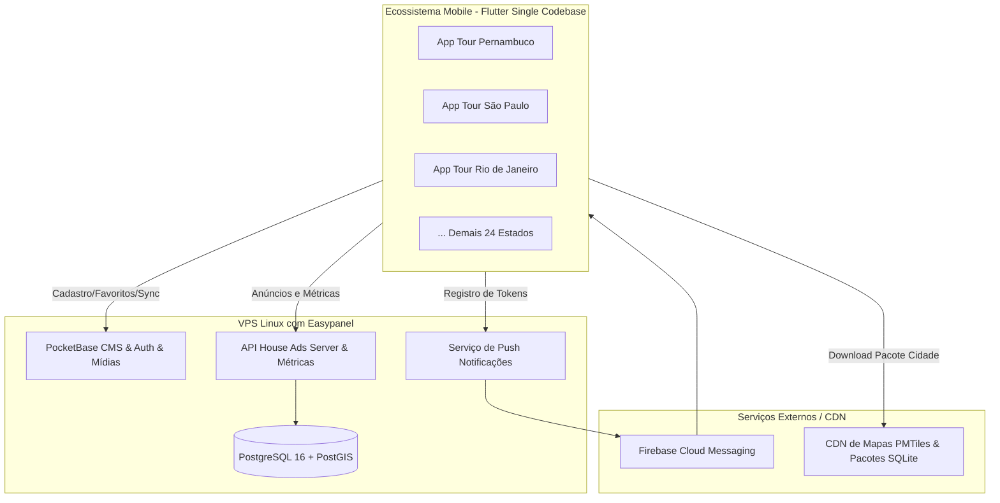
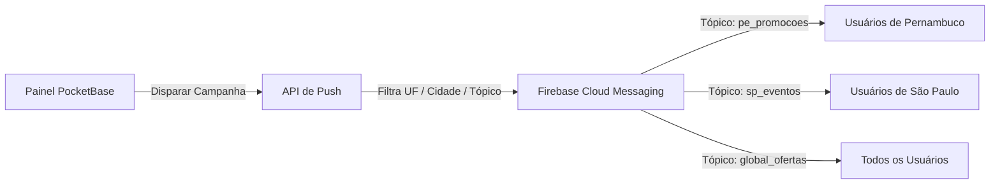

# Plano de Implementação: Ecossistema One Tour (27 Estados)

> **Documento:** Plano de Engenharia, Diretrizes Estratégicas e Implementação em Fases  
> **Versão:** 1.3  
> **Data:** 22 de Outubro de 2026  
> **Nicho:** City Tour, Turismo Estadual, Roteirização Inteligente, Rede House Ads e Push Notificações  
> **Plataformas:** Android e iOS (27 Aplicativos - 26 Estados + Distrito Federal)

---

## 1. Apresentação do Projeto, Contexto Estratégico e Guia para Agentes de IA

> [!IMPORTANT]
> **LEITURA OBRIGATÓRIA PARA QUALQUER AGENTE DE IA OU ENGENHEIRO:**  
> Este capítulo define a visão de negócio, os aprendizados da engenharia reversa do app de referência e as regras arquiteturais inegociáveis. Qualquer agente que assumir este projeto deve seguir rigorosamente as decisões aqui documentadas para manter a coerência técnica, funcional e comercial.

### 1.1. O Que É o Projeto One Tour?
O **One Tour** é um ecossistema comercial e tecnológico composto por **27 aplicativos móveis independentes** (um para cada estado brasileiro e o Distrito Federal — ex: *Tour Pernambuco*, *Tour São Paulo*, *Tour Bahia*, etc.), focados em:
1. **Guia e City Tour Municipal:** Apresentação rica de pontos turísticos, rotas culturais, praias, patrimônio histórico, gastronomia e informações úteis de cada cidade do estado.
2. **Roteirização Inteligente (AI Trip Planner):** Um assistente que monta itinerários completos dia a dia, personalizados pelo perfil do turista (orçamento, ritmo, dias de estadia, viagens com crianças ou solo).
3. **Expansão da Rede Própria de Anúncios (House Ads):** Monetização e tráfego cruzado entre os aplicativos da rede, além da venda direta de espaços de publicidade qualificada para a cadeia de turismo local (hotéis, pousadas, restaurantes, passeios de barco e receptivos).
4. **Push Notificações Segmentadas:** Canal contínuo de retenção e vendas com disparos direcionados por estado, cidade ou interesse (ofertas sazonais, pacotes turísticos, notícias e novidades).

---

### 1.2. DNA de Negócio: O Modelo "ZapScore" Aplicado ao Turismo
O cliente já opera com sucesso a rede **ZapScore**, onde construiu dezenas de aplicativos de futebol segmentados por campeonato e estado (ex: `com.zapscore.estadualpernambucano`, `com.zapscore.estadualpaulista`, `com.zapscore.estadualbaiano`).
* **Vantagem de ASO (App Store Optimization):** O turista ou morador que busca "O que fazer em Pernambuco" ou "Turismo em Bonito MS" encontra um app dedicado com identidade visual e conteúdo hiper-local, gerando muito mais downloads e conversão do que um app genérico nacional.
* **Rede de Distribuição Proprietária:** Ao deter 27 aplicativos nas lojas, o ecossistema cria uma audiência cativa massiva e qualificada. O app de Pernambuco promove os apps dos estados vizinhos (Alagoas, Paraíba, Ceará), gerando instalações cruzadas a custo zero de aquisição (CAC).

---

### 1.3. Lições Críticas da Engenharia Reversa do "Trip AI Plan"
O aplicativo de referência instalado no celular (`com.aitrippack.app`, v1.0.5) foi completamente inspecionado em nível de código nativo (`libapp.so`), banco de dados e tráfego de CDN. As descobertas fundamentais que **devem ser preservadas** neste projeto são:

1. **Roteirizador "AI" é Híbrido, Local e sem Custo por Chamada:**
   * O app **não** faz requisições síncronas a APIs caras de LLM (como OpenAI ou Claude) a cada roteiro gerado pelo usuário.
   * Ele baixa pacotes por cidade contendo um banco `pack.sqlite`. Esse banco contém:
     * A tabela `place` com atributos pré-classificados (`score`, `fame`, `interest`, `duration_min`, `setting`, `kid_friendly`, `must_see`).
     * A tabela `matrix` com uma matriz pré-calculada de tempos e distâncias a pé e de carro (`from_id`, `to_id`, `walk_min`, `drive_min`) entre todos os pontos turísticos relevantes.
   * O aplicativo executa em Dart um **algoritmo de otimização combinatória local (Problema do Caixeiro Viajante com janelas de tempo)**. O roteiro é gerado em menos de 1 segundo, com pausa inteligente para almoço (`is_lunch`), funciona sem conexão à internet e tem **custo R$ 0,00 de servidor**.
2. **Mapas 100% Offline com MapLibre GL e PMTiles:**
   * Em vez de pagar centenas de dólares por mês para Google Maps ou Mapbox, o app faz download de arquivos compactados `.pmtiles` (tiles vetoriais do OpenStreetMap).
   * O mapa vetorial da cidade é renderizado localmente pelo MapLibre, sem consumo de 4G/5G do turista.
3. **Configuração Remota Leve para Anúncios:**
   * Um simples JSON remoto (`app_config.json`) liga/desliga anúncios e define os blocos por tela dinamicamente sem necessidade de novas compilações na Play Store.

---

### 1.4. Diretrizes Inegociáveis para Agentes de IA em Fases Posteriores

Para que qualquer outro agente de IA ou desenvolvedor dê sequência ao projeto com total fidelidade e sem retrabalho, **obedeça rigorosamente a estas 5 regras:**

* **REGRA 1: Base de Código Única (Single Codebase Multi-Flavor):**
  * NUNCA crie 27 repositórios diferentes de código mobile.
  * O projeto possui apenas um repositório Flutter (`/mobile`), onde cada estado é configurado como um *Product Flavor* (`pe`, `sp`, `rj`, `ba`, etc.), compartilhando 100% dos widgets, modelos, lógica de mapas e roteirização.
* **REGRA 2: Filosofia Offline-First:**
  * O turista viaja para áreas com sinal precário (serras, praias remotas, estradas). O app DEVE funcionar sem internet após o download inicial do pacote da cidade.
  * NUNCA torne o app refém de conexão constante para abrir roteiros, ver mapas ou ler dados turísticos já baixados.
* **REGRA 3: Separação Rígida entre PocketBase e PostgreSQL:**
  * **PocketBase:** É exclusivamente a interface visual de CMS/Backoffice e autenticação. É onde editores humanos cadastram cidades, pontos turísticos, fazem upload de fotos e banners da House Ads.
  * **PostgreSQL + PostGIS:** É o motor de dados espaciais analíticos e telemetria de alta performance do Ad Server (gravação de milhões de visualizações e cliques de anúncios sem travar o CMS).
  * Não crie acoplamentos desnecessários ou dependências circulares entre os dois bancos.
* **REGRA 4: Infraestrutura Econômica Autônoma (VPS + Easypanel):**
  * Toda a infraestrutura backend roda em contêineres Docker orquestrados pelo Easypanel em uma VPS simples (Hetzner, Hostinger ou similar).
  * Evite introduzir serviços gerenciados caros de nuvens públicas (AWS, Firebase pago por leitura, etc.) que inviabilizem o modelo de custo fixo baixo.
* **REGRA 5: Respeito à Sequência do Plano:**
  * Não pule etapas. Primeiro valida-se a infraestrutura e o app piloto do estado polo (Pernambuco). Somente após o piloto estar redondo é que se realiza a industrialização e o rollout dos demais 26 estados com Fastlane.

---

## 2. Visão Geral e Arquitetura do Sistema



---

## 3. Stack Tecnológica Definida

| Camada | Tecnologia | Função no Ecossistema |
| :--- | :--- | :--- |
| **Mobile** | Flutter (Dart AOT) | Código único para 27 apps via *Product Flavors*. |
| **Gerenciamento de Estado** | Riverpod | Injeção de dependência reativa e desacoplada. |
| **Navegação** | GoRouter | Roteamento declarativo com suporte a Deep Linking. |
| **Mapas & Vetores** | MapLibre GL + PMTiles | Mapas vetoriais 100% offline sem custo de Google Maps. |
| **Banco Local App** | SQLite (`sqlite3`) | Armazenamento de pontos turísticos (`pack.sqlite`) e viagens (`user.sqlite`). |
| **Hospedagem & Deploy** | VPS Linux + Easypanel | Orquestração Docker com SSL automático e deploy contínuo. |
| **CMS & Backoffice** | PocketBase (Go + SQLite) | Cadastro de cidades, atrações, banners de anúncios e upload de mídias. |
| **Banco Central & Ads** | PostgreSQL 16 + PostGIS | Motor espacial de proximidade, métricas e telemetria da rede House Ads. |
| **Push Notificações** | Firebase Cloud Messaging (FCM) | Notificações push segmentadas por tópicos (UF, cidade, categoria). |
| **Esteira de Build** | Fastlane + GitHub Actions | Compilação e envio automatizado dos 27 apps para a Google Play / App Store. |

---

## 4. Arquitetura de Telas, Layout e Experiência do Usuário (UI/UX)

### 4.1. Filosofia de Interface e Usabilidade Mobile
* **Navegação Ergonométrica:** Elementos de ação primária acessíveis na metade inferior da tela para uso confortável com apenas uma mão durante caminhadas ou deslocamentos.
* **Design Imersivo e Fotográfico:** Ênfase em imagens de alta qualidade dos destinos, com cantos arredondados modernos (BorderRadius 16px), micro-interações suaves e transições fluidas.
* **Transparência de Conectividade:** Indicadores claros de status offline ("Disponível Offline", "Baixando Pacote 45%", "Sincronizado").
* **Tipografia e Cores:**
  * Tipografia moderna e altamente legível (Google Fonts *Inter* ou *Outfit*).
  * Design tokens dinâmicos por estado (definidos no Flavor), garantindo que cada app tenha identidade regional sem duplicar telas.
  * Suporte nativo a **Modo Escuro (Dark Mode)** e **Modo Claro (Light Mode)**.

---

### 4.2. Estrutura Global de Navegação (Bottom Navigation Bar)
O aplicativo adota barra de navegação inferior persistente com 4 destinos:
1. **Explorar (`/cidades`):** Vitrine do estado, busca de municípios e categorias.
2. **Roteiros (`/roteiros`):** Central de viagens, assistente de criação e itinerários gerados.
3. **Mapa (`/mapa`):** Visualização cartográfica offline em tela cheia com pins e rotas.
4. **Salvos (`/favoritos`):** Lugares favoritados e gerenciamento de pacotes offline baixados.

---

### 4.3. Detalhamento Tela a Tela

```
┌────────────────────────────────────────────────────────────────────────┐
│                        MAPA DE TELAS DO APP                            │
├─────────────────┬──────────────────┬─────────────────┬─────────────────┤
│    EXPLORAR     │   TELA CIDADE    │   WIZARD ROTEIRO│ ROTEIRO GERADO  │
│ ┌─────────────┐ │ ┌──────────────┐ │ ┌─────────────┐ │ ┌─────────────┐ │
│ │Busca & UF   │ │ │Hero Header   │ │ │Quantos dias?│ │ │[D1] [D2] [D3│ │
│ │Carrossel Cid│ │ │Status Offline│ │ │Qual ritmo?  │ │ │09:00 Parada1│ │
│ │Filtro Tags  │ │ │Guia Cultural │ │ │Interesses?  │ │ │🚶 8 min     │ │
│ │House Ads Card │ │Lista Atrações│ │ └─────────────┘ │ │12:30 Almoço 🍽│ │
│ │Feed Atrações│ │ │[FAB: Roteiro]│ │ [Gerar Agora] │ │ │14:00 Parada2│ │
│ └─────────────┘ │ └──────────────┘ │                 │ └─────────────┘ │
└─────────────────┴──────────────────┴─────────────────┴─────────────────┘
```

#### A. Tela Principal do Estado (Home / Explorar - `/cidades`)
* **Header Temático:**
  * Saudação personalizada com brasão/logo do estado (ex: *Tour Pernambuco*).
  * Widget de previsão do tempo da capital.
  * Barra de busca rápida com preenchimento preditivo de cidades e atrações.
* **Carrossel de Cidades Polo:**
  * Cards horizontais em destaque com foto de capa imersiva, nome do município e selo (ex: *"Recife • Capital Multicultural"*, *"Porto de Galinhas • Piscinas Naturais"*).
* **Filtros por Tags em Pílulas (Chips Horizontais):**
  * `🏖️ Praias & Litoral`, `🏛️ Cultura & História`, `🍲 Gastronomia`, `🌿 Ecoturismo & Trilhas`, `🎉 Eventos & Noite`.
* **Bloco Nativo House Ads:**
  * Card patrocinado orgânico (ex: *"Passeio de Catamarã em Olinda"* ou promoção cruzada *"Conheça o App Tour Paraíba"*).
* **Feed Vertical de Atrações em Alta:**
  * Lista de atrações com nota de avaliação (*score*), tempo médio de visitação e badge *"Imperdível"*.

#### B. Tela de Detalhes da Cidade (`/cidade/:id`)
* **Hero Header Panorâmico:**
  * Foto da cidade em alta definição com gradiente de proteção de leitura.
  * Botão de Ação Rápida de Download:
    * Se não baixado: `[ ⬇ Baixar Guia e Mapa Offline (12 MB) ]`
    * Se baixado: `[ ✓ Pronto Offline • 12 MB ]`
* **Guia Rápido Municipal:**
  * Resumo histórico e dicas práticas (*Melhor época para ir*, *Como circular*, *Dicas locais*).
* **Lista de Atrações da Cidade:**
  * Agrupamento por bairros/regiões turísticas com fotos, horários e distâncias relativas.
* **Floating Action Button (FAB) de Destaque:**
  * Botão flutuante estilizado: **"Montar Roteiro Inteligente"**.

#### C. Assistente de Roteirização (Wizard AI Planner - `/roteiro/novo`)
Fluxo em modal/bottom-sheet ágil em 3 perguntas antes da otimização:
1. **Duração:** Seletor de 1 a 7 dias de viagem.
2. **Ritmo de Passeio:**
   * *Tranquilo:* 2 a 3 pontos por dia (ideal para descanso).
   * *Moderado:* 3 a 4 pontos por dia.
   * *Intenso:* 5 a 6 pontos por dia (aproveitamento máximo).
3. **Perfil e Interesses:**
   * *Com quem viaja:* Solo, Casal, Amigos ou Família com Crianças (*filtro kid-friendly ativado*).
   * *Prioridades:* Marcar checkboxes de História, Praias, Gastronomia ou Compras.
* **Gatilho:** Botão **"Gerar Itinerário Otimizado"** (execução do algoritmo combinatório local em < 1 segundo).

#### D. Tela do Roteiro Pronto e Itinerário (`/roteiro/:id`)
* **Seletor de Abas de Dias:** Navegação superior por pílulas `[ Dia 1 ]` `[ Dia 2 ]` `[ Dia 3 ]`.
* **Timeline Vertical Cronológica:**
  * `09:00` • **Marco Zero do Recife** (Tempo de visitação: 1h30).
  * `🚶‍♂️ 8 min a pé (600m)` até a próxima parada.
  * `10:45` • **Rua do Bom Jesus e Sinagoga**.
  * `12:30` • 🍽️ **Pausa Almoço:** Sugestão do polo gastronômico local.
  * `14:00` • **Museu Cais do Sertão** (Tempo de visitação: 2h).
* **Ações do Roteiro:**
  * Botão *"Ver no Mapa"* (plota todos os pontos do dia com linha de rota traçada).
  * Botão *"Compartilhar/Exportar"* (abre o intersticial suave da House Ads e gera card visual para redes sociais/PDF).

#### E. Tela do Mapa Offline Interativo (`/mapa`)
* **Visualização Cartográfica em Tela Cheia:** Renderização via MapLibre GL usando os tiles vetoriais PMTiles.
* **Pins Inteligentes:** Marcadores customizados com ícone da categoria (praia, museu, restaurante).
* **Linha de Trajeto (Route Path):** Desenho vetorial da sequência de pontos do dia selecionado.
* **Card Deslizante de Atração:** Ao tocar em um pin, exibe card inferior com foto, nota em estrelas, posição no ranking, horário e botão *"Traçar Rota a Pé / De Carro"*.

---

### 4.4. Mecânica Social: Avaliações, Estrelas, Curtidas, Score e Rankings Comunitários

A inclusão de prova social transforma os 27 aplicativos de guias estáticos em uma **rede dinâmica e colaborativa**, aumentando o tempo de permanência, o engajamento e a precisão do algoritmo de roteiros.

```
┌────────────────────────────────────────────────────────────────────────┐
│               FLUXO DA MECÂNICA SOCIAL & OFFLINE-FIRST                 │
├────────────────────────────┬─────────────────────────────┬─────────────┤
│      APP (CLIENTE)         │      OFFLINE LOCAL          │   BACKEND   │
│ ┌────────────────────────┐ │ ┌─────────────────────────┐ │ ┌─────────┐ │
│ │ ❤️ Curtida (1 Toque)   │─┼─►│ Grava no user.sqlite   │ │ │Pocket-  │ │
│ │ ⭐ Estrelas (1 a 5)    │ │ │ (fila pendente de sync) │ │ │Base     │ │
│ │ 🏆 Badge #1 no Ranking │ │ └───────────┬─────────────┘ │ │ & Post- │ │
│ └────────────────────────┘ │             │ (ao ter net)  │ │ greSQL  │ │
│                            │             └───────────────┼►│Recalcula│ │
│ ┌────────────────────────┐ │ ┌─────────────────────────┐ │ │Scores & │ │
│ │ Exibe médias & ranks   │◄┼─┤ Lê do pack.sqlite       │◄┼─┤Rankings │ │
│ │ sem gastar internet    │ │ │ (dados consolidados)    │ │ └─────────┘ │
│ └────────────────────────┘ │ └─────────────────────────┘ │             │
└────────────────────────────┴─────────────────────────────┴─────────────┘
```

#### 1. Componentes de Prova Social e Interface:
* **Curtida Rápida (❤️ com 1 Toque):**
  * Ícone flutuante em cada card de atração e foto de capa.
  * Tocar salva instantaneamente o ponto na aba *"Salvos/Favoritos"* e incrementa o contador local com animação háptica suave.
* **Sistema de Avaliação por Estrelas (⭐ 1.0 a 5.0):**
  * Modal interativo com toque nas 5 estrelas exibido ao final da visita ou na tela de detalhes.
  * Exibição visual de média ponderada e volume de votos (ex: `⭐ 4.9 (1.420 avaliações)`).
* **Badges de Ranking Estadual e Municipal:**
  * Selos visuais com destaque dourado/prateado nos cards:
    * `🥇 #1 Mais Curtida de Pernambuco`
    * `🥈 #2 em Gastronomia de Olinda`
    * `🥉 Top 5 Escolha dos Viajantes`
* **Carrossel Temático na Home:**
  * Seção *"Os Mais Votados do Estado"* destacando os campeões de preferência dos turistas.

#### 2. Alimentação do Algoritmo de Roteirização (Score Comunitário Dinâmico):
* O algoritmo VRP local consome a pontuação para decidir a ordem e prioridade dos locais no itinerário.
* **Fórmula do Score Comunitário:**
  $$\text{Score} = (\text{Média Estrelas} \times 0.40) + (\text{Curtidas Normalizadas} \times 0.30) + (\text{Peso Editorial Curadoria} \times 0.30)$$
* Atrações com maiores notas e curtidas sobem organicamente no ranking e tornam-se paradas prioritárias nos roteiros automáticos.

#### 3. Arquitetura Técnica Offline-First e Sincronização Assíncrona:
* **Consumo 100% Offline:** Os valores consolidados (`rating_avg`, `rating_count`, `likes_count`, `rank_posicao`) são pré-compilados pelo backend dentro do `pack.sqlite`. O turista visualiza estrelas e rankings sem gastar 1 byte de dados móveis.
* **Gravação Desconectada:** Quando o usuário curte ou avalia sem internet, o voto é salvo na tabela `pending_votes` do banco local `user.sqlite`.
* **Sync em Background Silencioso:** Um worker do app escuta o status da rede. Ao detectar Wi-Fi ou sinal de dados, despacha os votos acumulados via endpoint leve (`POST /api/v1/telemetry/vote`) e atualiza o estado local.

#### 4. Estratégia de Segurança e Aprovação Rápida nas Lojas (Apple e Google):
* **Foco em Métricas Numéricas (Fase 1 e Piloto):**
  * A interação é restrita a **estrelas, curtidas e seleções de tags**.
  * **Não implementar comentários de texto aberto nesta etapa inicial:** Isso evita que a Apple classifique o app como *User Generated Content (UGC)* irrestrito, dispensando a exigência burocrática de moderação humana em tempo real, termos de bloqueio de usuários e filtros de linguagem que costumam atrasar a aprovação da versão 1.0.

---

## 5. Fases de Implementação

---

### FASE 1: Fundação do App Mobile (Flutter Multi-Flavor)
*Objetivo: Criar a base de código único capaz de compilar os 27 aplicativos com marcas e configurações dinâmicas.*

1. **Configuração de Product Flavors:**
   * Configuração no Gradle/Xcode para 27 variantes (`pe`, `sp`, `rj`, `ba`, `mg`, etc.).
   * Definição de `applicationId` por estado (ex: `com.onetour.pe`, `com.onetour.sp`).
   * Estrutura de assets dinâmicos por flavor:
     * `assets/flavors/pe/` (ícones, logos, splash screen, brasão/identidade).
     * Paleta de cores temática por estado (tokens de estilo customizáveis).
2. **Design System Base:**
   * Componentes reutilizáveis: Cards de atrações, carrossel de cidades, barra de busca, filtros de categorias.
   * Suporte a Modo Escuro / Modo Claro.
3. **Navegação Modular (GoRouter):**
   * Rotas: `/` (Splash/Boas-vindas), `/cidades`, `/cidade/:id`, `/roteiros`, `/roteiro/novo`, `/mapa`, `/configuracoes`.

---

### FASE 2: Infraestrutura de Servidor (VPS + Easypanel)
*Objetivo: Subir a infraestrutura autônoma, de baixo custo fixo e alta capacidade de entrega.*

1. **Setup da VPS com Easypanel:**
   * Instalação do Docker e Easypanel na VPS.
   * Configuração de domínios com SSL automático (Let's Encrypt).
2. **Deploy do PocketBase (Backoffice & CMS):**
   * Subir contêiner PocketBase para ser a interface de curadoria.
   * Criação das coleções no PocketBase:
     * `estados` (sigla, nome, status, versao_pacote).
     * `cidades` (nome, estado_id, lat, lon, capa, destaque).
     * `atracoes` (nome, categoria, horário, duração, fotos, gratuito, kid_friendly, rating_avg, rating_count, likes_count, rank_posicao).
     * `campanhas_ads` (título, imagem, link_destino, uf_alvo, data_fim, ativo).
3. **Deploy do PostgreSQL com extensão PostGIS:**
   * Configuração do banco para consultas de proximidade (`ST_DWithin`, rotas).
   * Estrutura de tabelas para ingestão de eventos, telemetria de anúncios e votos comunitários (likes e estrelas).
4. **Armazenamento de Arquivos Estáticos:**
   * Configuração de bucket S3 compatível (MinIO ou Cloudflare R2) para servir os arquivos pesados de mapas (`.pmtiles`) e bancos (`.sqlite`).

---

### FASE 3: Motor de Turismo Offline e Roteirizador Inteligente
*Objetivo: Replicar o modelo do Trip AI Plan, com geração instantânea de itinerários sem custo de IA por chamada.*

1. **Pipeline de Geração de Pacotes de Cidades:**
   * Script gerador do banco `pack.sqlite` para cada cidade:
     * Tabela `place`: Pontos turísticos, restaurantes, praias, museus com atributos pré-classificados (`score`, `fame`, `rating_avg`, `likes_count`, `rank_posicao`).
     * Tabela `matrix`: Matriz pré-computada de distância e tempo de caminhada/carro entre os principais pontos da cidade.
   * Geração do arquivo `map.pmtiles` com o mapa vetorial local (extraído do OpenStreetMap).
2. **Algoritmo de Roteirização Local no App:**
   * Implementação em Dart do algoritmo combinatório (VRP com janelas de tempo):
     * Entrada: Quantidade de dias, interesses (história, praias, gastronomia), hotel de partida e ritmo (tranquilo ou intenso).
     * Saída: Cronograma hora a hora, agrupando atrações por proximidade geográfica para evitar deslocamentos desnecessários.
     * Inserção automática de pausas de almoço (`is_lunch`) e cálculo de tempo de trajeto.
3. **Integração do Mapa com MapLibre GL:**
   * Renderização das camadas vetoriais do arquivo PMTiles sem uso de dados de rede móvel.
   * Plotagem dos pins das atrações do roteiro e traçado da rota conectando as paradas do dia.

---

### FASE 4: Rede Própria de Anúncios (House Ads Network)
*Objetivo: Monetizar e gerar tráfego cruzado entre os 27 aplicativos do ecossistema.*

1. **Componente House Ads no Flutter:**
   * Bloco de Banner Nativo (integrado de forma orgânica nas listas de atrações).
   * Card em Destaque no Topo da Cidade (ex: "Pousada Recomendada", "Passeio de Barco").
   * Intersticial Suave (exibido apenas ao salvar ou exportar um roteiro).
2. **Serviço de Entrega de Anúncios (Ad Server):**
   * Endpoint de requisição de banners parametrizado por:
     * `uf` (Estado do app atual).
     * `cidade` (Cidade navegada no momento).
     * `posicao` (home, lista_atracoes, roteiro).
3. **Funcionalidades Estratégicas da Rede:**
   * **Cross-Promotion:** App de Pernambuco divulga o app da Paraíba e Alagoas para turistas da região Nordeste.
   * **Monetização Direta:** Venda de cotas publicitárias locais para hotéis, pousadas e restaurantes municipais.
   * **Telemetria no PostgreSQL:** Registro consolidado de impressões, cliques e CTR.

---

### FASE 5: Sistema de Push Notificações Segmentadas
*Objetivo: Engajamento contínuo, envio de promoções, alertas de eventos, novidades e ofertas locais.*



1. **Arquitetura de Tópicos (FCM Topic Messaging):**
   * Cada app inscreve o usuário automaticamente nos tópicos pertinentes com base no seu estado e preferências:
     * **Por Estado:** `${uf}_geral` (ex: `pe_geral`, `sp_geral`).
     * **Por Categoria:** `${uf}_promocoes`, `${uf}_eventos`, `${uf}_gastronomia`, `${uf}_noticias`.
     * **Por Cidade de Interesse:** `${uf}_${cidade_slug}` (ex: `pe_recife`, `pe_portodegalinhas`, `sp_camposdojordao`).
2. **Fluxo no Aplicativo Flutter:**
   * Solicitação de permissão de notificação no momento ideal (após o usuário interagir com o primeiro roteiro).
   * Armazenamento e sincronização do token FCM no banco com a tag do app.
   * Manipulador de notificações em primeiro plano (`foreground`), plano de fundo (`background`) e ação de clique (Deep Linking direto para a atração ou promoção anunciada).
3. **Disparador no Backoffice (PocketBase):**
   * Interface administrativa para criação e envio de notificações:
     * Título, corpo da mensagem, imagem de capa (rich notification).
     * Destino: Todos os estados, estado específico ou cidade específica.
     * Ação ao tocar: Abrir tela de detalhes de atração, link externo de parceiro ou cupom de desconto.

---

### FASE 6: Piloto e Validação (App Modelo: Pernambuco)
*Objetivo: Lançar e validar 100% das funcionalidades em um estado polo antes da replicação em massa.*

1. **Cadastramento de Dados Reais de PE:**
   * Recife, Olinda, Porto de Galinhas, Praia dos Carneiros e Fernando de Noronha.
   * Compilação dos arquivos `pack.sqlite` e `map.pmtiles` das cidades polo.
2. **Testes do Ciclo Completo:**
   * Funcionamento sem internet (modo avião ativado).
   * Geração de roteiro de 3 e 5 dias.
   * Exibição de banners da House Ads de parceiros locais.
   * Envio de push de teste com promoção de passeio local.
3. **Publicação nas Lojas:**
   * Lançamento na Google Play Store e Apple App Store sob o nome **Tour Pernambuco: Guia e Roteiros**.

---

### FASE 7: Industrialização e Rollout para os 27 Estados
*Objetivo: Automatizar a esteira para compilar, assinar e subir os 26 estados restantes em lote.*

1. **Configuração da Esteira de CI/CD (Fastlane + GitHub Actions):**
   * Criação de script `Fastfile` com loop por estado:
     ```ruby
     estados = ['pe', 'sp', 'rj', 'ba', 'mg', 'ce', 'pr', 'sc', 'rs', ...]
     estados.each do |uf|
       lane "deploy_#{uf}".to_sym do
         build_android_app(flavor: uf)
         upload_to_play_store(track: 'production', package_name: "com.onetour.#{uf}")
       end
     end
     ```
2. **Matriz de Cidades por Estado:**
   * Scripts automatizados para importar dados abertos (OpenStreetMap / WikiVoyage) e popular as principais cidades de cada estado.
3. **Lançamento Escalonado por Regiões:**
   * **Onda 1:** Nordeste (9 estados - sinergia imediata de turismo regional).
   * **Onda 2:** Sudeste (4 estados - maior densidade de turistas e anunciantes).
   * **Onda 3:** Sul (3 estados).
   * **Onda 4:** Centro-Oeste e Norte (11 estados + DF).

---

## 6. Matriz de Entregáveis e Cronograma Estimado

| Fase | Foco Principal | Tempo Estimado |
| :---: | :--- | :---: |
| **Fase 1** | Base Flutter Multi-Flavor & Design System | 2 a 3 semanas |
| **Fase 2** | VPS, Easypanel, PocketBase & PostgreSQL | 1 a 2 semanas |
| **Fase 3** | Motor Offline (PMTiles + SQLite + Algoritmo de Roteiro) | 3 semanas |
| **Fase 4** | Servidor e SDK Mobile House Ads | 2 semanas |
| **Fase 5** | Módulo de Push Notificações Segmentadas (FCM) | 1 semana |
| **Fase 6** | App Piloto (Pernambuco) & Validação em Produção | 2 semanas |
| **Fase 7** | Automação CI/CD Fastlane e Rollout dos 27 Estados | 3 a 4 semanas |
| **Total** | **Ecossistema Completo Operacional** | **~14 a 16 semanas** |

---

## 7. Próximos Passos Imediatos

1. Inicializar o repositório base Flutter em `f:\One_tour` com a estrutura de flavors configurada.
2. Criar os scripts de configuração do Easypanel (Dockerfiles e compose files para PocketBase e PostgreSQL).
3. Estruturar a modelagem das tabelas do banco local (`pack.sqlite`) para a primeira cidade piloto.
